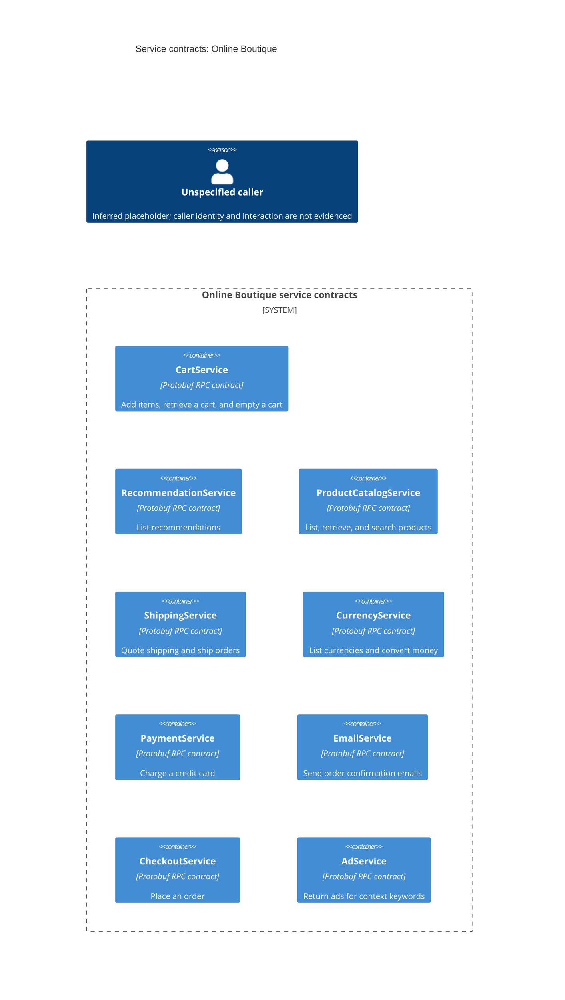

# Online Boutique architecture (Run A)

## Agent

GitHub Copilot using Copilot SDK in VS Code; model not known.

## Files read

- `AGENTS.md`
- `prompts/1-recover-architecture.md`
- `system/online-boutique/protos/demo.proto`

## Containers table

The evidence declares service contracts, but does not establish that each is deployed as a separate runtime container. Technologies below describe only what the contract file establishes.

| Name | Technology/language | Responsibility | Evidence |
|---|---|---|---|
| CartService | Protobuf RPC contract; implementation technology not evidenced | Add items, retrieve a cart, and empty a cart | `system/online-boutique/protos/demo.proto` (`CartService`) |
| RecommendationService | Protobuf RPC contract; implementation technology not evidenced | List recommendations using a user ID and product IDs | `system/online-boutique/protos/demo.proto` (`RecommendationService`) |
| ProductCatalogService | Protobuf RPC contract; implementation technology not evidenced | List, retrieve, and search products | `system/online-boutique/protos/demo.proto` (`ProductCatalogService`) |
| ShippingService | Protobuf RPC contract; implementation technology not evidenced | Get a shipping quote and ship an order | `system/online-boutique/protos/demo.proto` (`ShippingService`) |
| CurrencyService | Protobuf RPC contract; implementation technology not evidenced | List supported currencies and convert money | `system/online-boutique/protos/demo.proto` (`CurrencyService`) |
| PaymentService | Protobuf RPC contract; implementation technology not evidenced | Charge a credit card for an amount | `system/online-boutique/protos/demo.proto` (`PaymentService`) |
| EmailService | Protobuf RPC contract; implementation technology not evidenced | Send an order confirmation email | `system/online-boutique/protos/demo.proto` (`EmailService`) |
| CheckoutService | Protobuf RPC contract; implementation technology not evidenced | Place an order | `system/online-boutique/protos/demo.proto` (`CheckoutService`) |
| AdService | Protobuf RPC contract; implementation technology not evidenced | Return ads for supplied context keywords | `system/online-boutique/protos/demo.proto` (`AdService`) |

## Dependencies table

No caller-to-callee runtime dependencies are established by the service and message declarations in the provided file.

| Caller → callee | Protocol | Evidence |
|---|---|---|
| None evidenced | Not evidenced | `system/online-boutique/protos/demo.proto` declares RPC operations but does not identify callers or transport |

## Mermaid diagram

This is a contract-level view, not a confirmed deployment view. The caller is an inferred placeholder; the file does not identify an end user or connect one to a service.

## Gaps

- The file defines nine RPC service contracts, but does not establish their implementations, deployment units, or programming languages. Service source files or deployment manifests would settle this.
- No service-to-service callers, runtime dependencies, or transport are specified. Client/server implementation files or deployment configuration would be needed to determine them.
- No user-facing entry point or external system is identified. A frontend implementation or deployment manifest would help establish the user interaction path.
- No data-store containers or persistence behavior are evidenced. Service implementation files or storage configuration would be needed.
