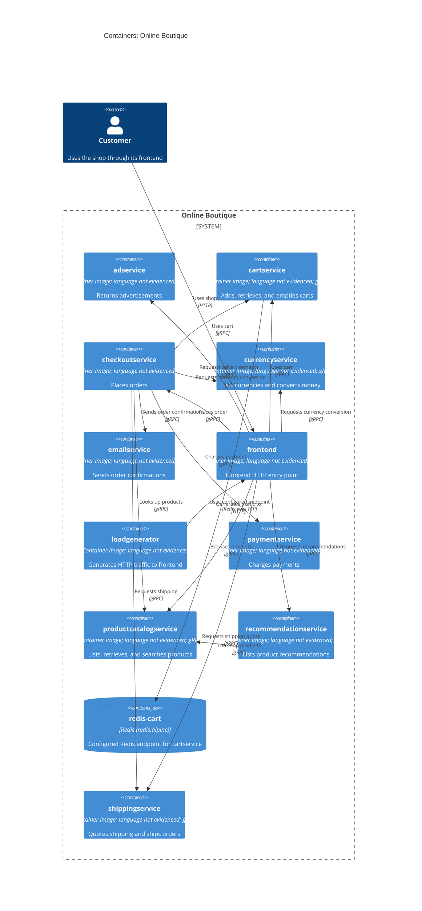

# Recovered Architecture: Online Boutique (Run B)

## Agent

AI assistant using Copilot SDK in VS Code; model not known.

## Files read

Task instructions:
- `AGENTS.md`
- `prompts/1-recover-architecture.md`

Evidence:
- `system/online-boutique/protos/demo.proto`
- `system/online-boutique/kubernetes-manifests/README.md`
- `system/online-boutique/kubernetes-manifests/adservice.yaml`
- `system/online-boutique/kubernetes-manifests/cartservice.yaml`
- `system/online-boutique/kubernetes-manifests/checkoutservice.yaml`
- `system/online-boutique/kubernetes-manifests/currencyservice.yaml`
- `system/online-boutique/kubernetes-manifests/emailservice.yaml`
- `system/online-boutique/kubernetes-manifests/frontend.yaml`
- `system/online-boutique/kubernetes-manifests/kustomization.yaml`
- `system/online-boutique/kubernetes-manifests/loadgenerator.yaml`
- `system/online-boutique/kubernetes-manifests/paymentservice.yaml`
- `system/online-boutique/kubernetes-manifests/productcatalogservice.yaml`
- `system/online-boutique/kubernetes-manifests/recommendationservice.yaml`
- `system/online-boutique/kubernetes-manifests/shippingservice.yaml`

## Containers table

| Name | Technology/language | Responsibility | Evidence |
|---|---|---|---|
| `adservice` | Container image `adservice`; language not evidenced. gRPC interface | Returns advertisements (`AdService.GetAds`). | `system/online-boutique/kubernetes-manifests/adservice.yaml`; `system/online-boutique/protos/demo.proto` (`AdService`) |
| `cartservice` | Container image `cartservice`; language not evidenced. gRPC interface | Adds, retrieves, and empties a user's cart (`CartService`). | `system/online-boutique/kubernetes-manifests/cartservice.yaml`; `system/online-boutique/protos/demo.proto` (`CartService`) |
| `checkoutservice` | Container image `checkoutservice`; language not evidenced. gRPC interface | Places an order (`CheckoutService.PlaceOrder`). | `system/online-boutique/kubernetes-manifests/checkoutservice.yaml`; `system/online-boutique/protos/demo.proto` (`CheckoutService`) |
| `currencyservice` | Container image `currencyservice`; language not evidenced. gRPC interface | Lists supported currencies and converts money (`CurrencyService`). | `system/online-boutique/kubernetes-manifests/currencyservice.yaml`; `system/online-boutique/protos/demo.proto` (`CurrencyService`) |
| `emailservice` | Container image `emailservice`; language not evidenced. gRPC interface | Sends order confirmations (`EmailService.SendOrderConfirmation`). | `system/online-boutique/kubernetes-manifests/emailservice.yaml`; `system/online-boutique/protos/demo.proto` (`EmailService`) |
| `frontend` | Container image `frontend`; language not evidenced. HTTP endpoint | Provides the frontend HTTP entry point. | `system/online-boutique/kubernetes-manifests/frontend.yaml` (`frontend` Deployment and LoadBalancer Service) |
| `loadgenerator` | Container image `loadgenerator`; language not evidenced | Generates HTTP traffic to the frontend. | `system/online-boutique/kubernetes-manifests/loadgenerator.yaml` (`FRONTEND_ADDR`) |
| `paymentservice` | Container image `paymentservice`; language not evidenced. gRPC interface | Charges a payment (`PaymentService.Charge`). | `system/online-boutique/kubernetes-manifests/paymentservice.yaml`; `system/online-boutique/protos/demo.proto` (`PaymentService`) |
| `productcatalogservice` | Container image `productcatalogservice`; language not evidenced. gRPC interface | Lists, retrieves, and searches products (`ProductCatalogService`). | `system/online-boutique/kubernetes-manifests/productcatalogservice.yaml`; `system/online-boutique/protos/demo.proto` (`ProductCatalogService`) |
| `recommendationservice` | Container image `recommendationservice`; language not evidenced. gRPC interface | Lists product recommendations (`RecommendationService.ListRecommendations`). | `system/online-boutique/kubernetes-manifests/recommendationservice.yaml`; `system/online-boutique/protos/demo.proto` (`RecommendationService`) |
| `redis-cart` | Redis (`redis:alpine`) | Cart service's configured Redis endpoint; specific stored data is not further described in the provided evidence. | `system/online-boutique/kubernetes-manifests/cartservice.yaml` (`REDIS_ADDR`, `redis-cart` Deployment and Service) |
| `shippingservice` | Container image `shippingservice`; language not evidenced. gRPC interface | Quotes shipping and ships orders (`ShippingService`). | `system/online-boutique/kubernetes-manifests/shippingservice.yaml`; `system/online-boutique/protos/demo.proto` (`ShippingService`) |

## Dependencies table

| Caller → callee | Protocol | Evidence |
|---|---|---|
| `loadgenerator` → `frontend` | HTTP | `system/online-boutique/kubernetes-manifests/loadgenerator.yaml` (`FRONTEND_ADDR`; init container requests `http://${FRONTEND_ADDR}`) |
| `frontend` → `adservice` | gRPC | `system/online-boutique/kubernetes-manifests/frontend.yaml` (`AD_SERVICE_ADDR`); `system/online-boutique/protos/demo.proto` (`AdService`) |
| `frontend` → `cartservice` | gRPC | `system/online-boutique/kubernetes-manifests/frontend.yaml` (`CART_SERVICE_ADDR`); `system/online-boutique/protos/demo.proto` (`CartService`) |
| `frontend` → `checkoutservice` | gRPC | `system/online-boutique/kubernetes-manifests/frontend.yaml` (`CHECKOUT_SERVICE_ADDR`); `system/online-boutique/protos/demo.proto` (`CheckoutService`) |
| `frontend` → `currencyservice` | gRPC | `system/online-boutique/kubernetes-manifests/frontend.yaml` (`CURRENCY_SERVICE_ADDR`); `system/online-boutique/protos/demo.proto` (`CurrencyService`) |
| `frontend` → `productcatalogservice` | gRPC | `system/online-boutique/kubernetes-manifests/frontend.yaml` (`PRODUCT_CATALOG_SERVICE_ADDR`); `system/online-boutique/protos/demo.proto` (`ProductCatalogService`) |
| `frontend` → `recommendationservice` | gRPC | `system/online-boutique/kubernetes-manifests/frontend.yaml` (`RECOMMENDATION_SERVICE_ADDR`); `system/online-boutique/protos/demo.proto` (`RecommendationService`) |
| `frontend` → `shippingservice` | gRPC | `system/online-boutique/kubernetes-manifests/frontend.yaml` (`SHIPPING_SERVICE_ADDR`); `system/online-boutique/protos/demo.proto` (`ShippingService`) |
| `checkoutservice` → `cartservice` | gRPC | `system/online-boutique/kubernetes-manifests/checkoutservice.yaml` (`CART_SERVICE_ADDR`); `system/online-boutique/protos/demo.proto` (`CartService`) |
| `checkoutservice` → `currencyservice` | gRPC | `system/online-boutique/kubernetes-manifests/checkoutservice.yaml` (`CURRENCY_SERVICE_ADDR`); `system/online-boutique/protos/demo.proto` (`CurrencyService`) |
| `checkoutservice` → `emailservice` | gRPC | `system/online-boutique/kubernetes-manifests/checkoutservice.yaml` (`EMAIL_SERVICE_ADDR`); `system/online-boutique/protos/demo.proto` (`EmailService`) |
| `checkoutservice` → `paymentservice` | gRPC | `system/online-boutique/kubernetes-manifests/checkoutservice.yaml` (`PAYMENT_SERVICE_ADDR`); `system/online-boutique/protos/demo.proto` (`PaymentService`) |
| `checkoutservice` → `productcatalogservice` | gRPC | `system/online-boutique/kubernetes-manifests/checkoutservice.yaml` (`PRODUCT_CATALOG_SERVICE_ADDR`); `system/online-boutique/protos/demo.proto` (`ProductCatalogService`) |
| `checkoutservice` → `shippingservice` | gRPC | `system/online-boutique/kubernetes-manifests/checkoutservice.yaml` (`SHIPPING_SERVICE_ADDR`); `system/online-boutique/protos/demo.proto` (`ShippingService`) |
| `recommendationservice` → `productcatalogservice` | gRPC | `system/online-boutique/kubernetes-manifests/recommendationservice.yaml` (`PRODUCT_CATALOG_SERVICE_ADDR`); `system/online-boutique/protos/demo.proto` (`ProductCatalogService`) |
| `cartservice` → `redis-cart` | Redis over TCP | `system/online-boutique/kubernetes-manifests/cartservice.yaml` (`REDIS_ADDR`; `redis-cart` Service port named `tcp-redis`) |

## Mermaid diagram

## Gaps

- `frontend.yaml` sets `SHOPPING_ASSISTANT_SERVICE_ADDR=shoppingassistantservice:80`, but the supplied manifest set does not define a `shoppingassistantservice` Deployment or Service. Its protocol and responsibility cannot be established from these files. It is therefore not modeled as a container or dependency. The corresponding service manifest and its interface definition would settle this.
- `kustomization.yaml` comments out `loadgenerator.yaml` and says the load-generator module is used during development. The load generator is declared in its own manifest and modeled above, but these files do not establish whether it is deployed in a particular environment.
- The service manifests expose container images but do not identify the services' implementation languages. Their gRPC interfaces and operations are evidenced by `demo.proto`; the language would require implementation or image metadata not included in the provided evidence.
- `kubernetes-manifests/README.md` says these manifests require Skaffold to insert image tags and are not directly deployable. The exact deployed image versions are not evidenced.
- No separate data stores for the other services, nor any external payment, email, or shipping provider, are evidenced in the provided files.
